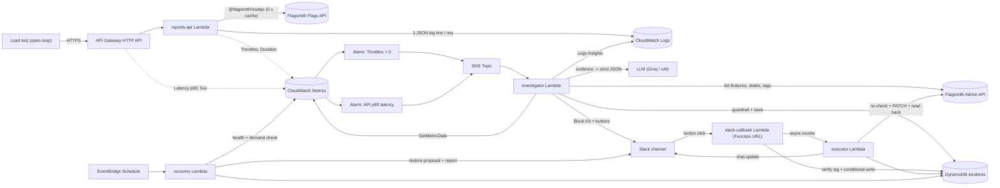

# ShedPilot

**An AI SRE agent that finds which feature is starving your API, proposes the smallest Flagsmith flag change that fixes it, waits for a human to approve in Slack, and verifies recovery from live metrics before proposing to turn the feature back on.**

Toggle Wars: The Flagsmith Experimentation Hackathon (WeMakeDevs x Flagsmith), Track 02: AI Agents and Feature Flags.

- **Demo video:** TODO: add link
- **Repo:** TODO: add link
- **Data:** 100% synthetic. The traffic comes from a load-test script against a demo API. No real users, no real data.

---

## The problem

When a serverless API hits a traffic spike, one heavy, non-essential feature (generating multi-page PDFs, large aggregations) can consume all available Lambda concurrency. AWS Lambda rejects synchronous requests above its concurrency limit instead of queuing them, so the heavy feature causes **collateral throttling** on critical routes like checkout.

A static kill switch needs a human to notice the alert, open CloudWatch, guess which feature is responsible, and toggle flags by hand. A script that does "alarm fires, disable everything" is not an agent and can switch off core functionality. ShedPilot closes the loop:

1. **Investigate.** On an alarm, the agent measures what happened: CloudWatch metrics plus a Logs Insights query over per-request logs that shows exactly which flagged feature consumed the compute.
2. **Decide.** An LLM returns a strict JSON proposal for the **minimum** set of flags to disable, with evidence, expected effect and user impact.
3. **Act, with approval.** Deterministic code checks the proposal against live Flagsmith state. A human approves in Slack. The LLM has no credentials and no tools that can change a flag.
4. **Verify and restore.** After approval the executor flips the flag and reads it back. A recovery check then waits for the service to be healthy before proposing to restore the flag, through the same approval path.

## Architecture




The app stack (demo API) deploys to `ap-south-1`. The agent stack deploys to `ap-southeast-1` by default, so a traffic spike on the app cannot throttle the agent that is trying to fix it.

One incident:

1. A CloudWatch alarm (`Throttles > 0` or API p90 latency) publishes to SNS and triggers `investigator`.
2. `investigator` claims an atomic DynamoDB lock (`LOCK#reports-api`), so concurrent alarms create **one** incident. It posts an "Investigating..." message to Slack, then waits for CloudWatch metrics to settle.
3. It queries `GetMetricData` (throttles, 5xx, concurrency, latency) and a Logs Insights query over the structured request logs (`feature_timings_ms.<flag>`). Every number in the Slack message carries the exact evidence window it came from.
4. It fetches live flag state, descriptions and tags from the Flagsmith Admin API and sends the compacted evidence to the LLM.
5. The guardrail checks every proposed action. Rejected actions are shown openly in Slack under **Blocked by the guardrail**.
6. A human clicks **Approve** or **Reject**. `slack-callback` verifies the Slack signature, does a conditional DynamoDB state transition, replies within 3 seconds, and invokes `executor` asynchronously.
7. `executor` re-reads live Flagsmith state, re-runs the guardrail, flips the flag, reads it back to verify, and updates the Slack message.
8. `recovery` runs on an EventBridge schedule. It checks that the service has been healthy for *N* complete minutes **and** that re-enabling fits in the spare concurrency headroom (Little's law over request logs for the degraded routes). When safe, it proposes the restore through the same approval path, then posts an incident report and releases the lock.

The full incident state machine, DynamoDB schema and decision log are in [docs/ARCHITECTURE.md](docs/ARCHITECTURE.md).

### Demo backend (`reports-api`)

One Lambda behind API Gateway with reserved concurrency `TODO: confirm value from template.yaml (observed peak: 10)`. All slowness comes from real work: PDFs are generated with `pdfkit`, and aggregation is a real CPU-bound loop. There are no `sleep` calls.

| Route | Flag | Sheddable | Behaviour when the flag is off |
|---|---|---|---|
| `GET /api/reports?format=pdf` | `pdf_export` | yes | Fast degraded 200 with a CSV link |
| `GET /api/reports?format=csv` | `basic_csv` | yes | Degraded response |
| `GET /api/reports/summary` | `rich_analytics` | yes | Summary without the heavy aggregation |
| `GET /api/checkout` | `checkout_core` | **no** | n/a. Deliberately untagged to prove the guardrail |

Each request writes one structured JSON log line: `request_id`, `route`, `features_evaluated`, `feature_timings_ms`, `duration_ms`, `status`.

### Agent components

| Lambda | Trigger | Job |
|---|---|---|
| `investigator` | SNS (alarms) | Lock, measure, propose via LLM, guardrail, post to Slack |
| `slack-callback` | Slack interactivity (Function URL) | Verify signature, conditional state transition, async invoke |
| `executor` | Async invoke | Re-check, flip flag via Admin API, read back, update Slack |
| `recovery` | EventBridge schedule | Health and demand checks, restore proposal, incident report |

## How ShedPilot uses Flagsmith

Flagsmith is the **only source of truth for feature state**. The app reads flags from it on every request, the agent reads its state to reason, and the one write the whole system performs (turning a feature off or back on) is a Flagsmith change. Two Flagsmith APIs are used, with strict key separation.

| Component | Flagsmith API | Auth | Purpose |
|---|---|---|---|
| `reports-api` | Flags API (`@flagsmith/nodejs`, remote evaluation, 5 s in-memory cache) | `X-Environment-Key` (`ser.*` server-side key in SSM) | Evaluates `pdf_export`, `basic_csv`, `rich_analytics`, `checkout_core`. Fail-safe defaults if Flagsmith is unreachable: `pdf_export` and `rich_analytics` off, `checkout_core` on. |
| `scripts/seed-flags.ts` | Admin API (`GET /environments/`, `POST /tags/`, `POST /features/`, `PATCH /features/{id}/`) | `Authorization: Api-Key <org-key>` | Idempotently seeds the `load-sheddable` tag and the four demo flags |
| `investigator` | Admin API (`GET /environments/`, `GET /projects/{id}/tags/`, `GET /projects/{id}/features/?environment={id}&page_size=100`) | `Authorization: Api-Key <org-key>` (read path) | Fetches live per-environment flag states, descriptions and resolved tag labels, so the LLM and the guardrail both see current state |
| `executor` | Admin API (`GET` and `PATCH /api/__future__/environments/{env_api_key}/features/{feature_id}/`) | `Authorization: Api-Key <org-key>` | The **only** runtime component that toggles flags. Reads the state back with `GET` right after the `PATCH` to verify |

### What lives in Flagsmith

- **Four flags** (`pdf_export`, `basic_csv`, `rich_analytics`, `checkout_core`) in one environment.
- **A `load-sheddable` tag.** This tag is the agent's permission boundary: a flag without it can never be proposed or changed. Three of the four flags carry it. `checkout_core` does not.
- **Flag descriptions** that the LLM reads as context.

### Flagsmith specifics we worked with

- **The write endpoint is experimental.** Environments on Feature Versioning v2 reject legacy `featurestates` writes, so `executor` uses `PATCH /api/__future__/environments/{env_key}/features/{feature_id}/`. This requires **Change Requests** to be disabled in the target environment.
- **Two keys, two blast radii.** The app only ever holds a server-side environment key. The org-level Admin key lives in SSM and is used only by the agent stack.
- **5 s flag cache in the app.** A flag flip takes effect within seconds, which matches the failures stopping 6 to 26 s after approval in the runs below.
- **Fail-safe defaults.** If Flagsmith is unreachable, the heavy features default to off and the core route defaults to on.

## Safety model

The agent reads production metrics and proposes changes to production. Safety lives in code, not in the prompt.

1. **The LLM has no tools.** It has zero credentials and zero Flagsmith access. It receives compacted numeric evidence and returns JSON.
2. **Strict schema and parser.** Requests use strict `json_schema` decoding (`proposalParser.ts`), string lengths are clipped, one malformed-JSON retry is allowed, and if the API fails the agent falls back visibly to deterministic rules.
3. **Double guardrail.** `checkShedActions` and `checkRestoreFlags` ([agent/lib/guardrails.ts](agent/lib/guardrails.ts)) require: the flag exists, is currently enabled, the action is `"disable"`, it carries `load-sheddable`, no duplicates, and at most 3 flags per proposal. The check runs at proposal time and again in `executor` immediately before calling Flagsmith.
4. **Human approval gate.** `executor` runs only if DynamoDB already holds `APPROVED` or `RESTORE_APPROVED`, written exclusively by `slack-callback` after Slack HMAC-SHA256 and 5-minute replay-window verification (`slackVerify.ts`) and an optional `APPROVER_USER_IDS` allowlist.
5. **Idempotency and audit.** Every status change is an atomic `TransactWriteCommand` that updates `META` conditionally on the expected status and appends an `EVENT#...` audit entry. Double clicks and Slack retries are harmless.
6. **Dry-run mode.** `DRY_RUN=true` runs the full Slack flow and logs the Flagsmith `PATCH` payloads without mutating Flagsmith.
7. **Isolation.** The agent runs in a different AWS region from the app it protects.

### Guardrail proof (red team)

`checkout_core` is not tagged `load-sheddable`, so no proposal that includes it can reach approval, even if the model suggests it. This is tested in `agent/test/` and can be demonstrated live with `TODO: document the red-team switch or test command`. A blocked proposal appears in Slack like this:

```text
🛡️ Blocked by the guardrail (never offered for approval):
• checkout_core: missing tag load-sheddable
```

## LLM provider

The LLM sits behind an `LlmProvider` interface. The default is `openai/gpt-oss-120b` served by Groq, with xAI Grok and a deterministic rule-based fallback also supported. The model is not Claude. The track does not require a specific model, and nothing in the design depends on which one is used, because code validates every proposal. Typical proposal latency in the runs below was 2.0 to 2.5 s.

## Results

Three live runs on Nov 27, 2026 against the deployed stack (`ap-south-1`). Each run hit the demo API at about 8 req/s with random arrivals (an open-loop generator that keeps sending regardless of responses), the alarm fired, the agent proposed, and a human approved.

| Run | Profile | Requests | Alarm | Human approval | Total failures | Last new failure | PDF served as degraded 200 | `pdf_export` share of compute |
|---|---|---|---|---|---|---|---|---|
| 1 | spike, 180 s | 1,431 | +31 s | +129 s | 568 | before 135 s | 286 | 91.3% |
| 2 | demo, 300 s | 2,458 | +65 s | +143 s | 660 | before 165 s | 957 | 94% |
| 3 | demo, 300 s | 2,354 | +30 s | +109 s | 530 | before 135 s | 1,031 | 92.2% |

- **Same diagnosis every time.** The agent proposed disabling `pdf_export` only, in all three runs, each time with measured evidence and the alternatives it rejected.
- **Failures stop after the flip.** In every run the failure count goes flat within about 25 s of the approval and stays flat to the end of the run (run 3: 530 failures at 135 s and still 530 at 300 s).
- **Time saved.** Alarm to human approval was 98 s, 78 s and 80 s, including the time to read the evidence and click. The manual path is opening CloudWatch, guessing the responsible feature and toggling by hand.
- **Collateral damage.** In run 3, `/api/checkout`, which is never shed, failed 47 of 228 requests (about 21%) while `pdf_export` held the concurrency. That is the reason to shed.

## Sample Slack proposal

From run 3, incident `inc-20261127-045609-4165`:

```text
reports-api: load shed
Diagnosis
The Lambda hit its concurrency limit (peakConcurrency 10) and throttled 286 requests
while p90 latency hit 4007 ms, far above the 2500 ms alarm threshold. 92.2% of the
compute time for served requests comes from the pdf_export feature (227 requests,
avg 3237 ms, p90 4242 ms).

What's wrong
Alarm shedpilot-reports-api-latency-p90 fired at 04:56:08 UTC.
Evidence window: 04:52:10 UTC – 04:57:10 UTC (queried after settle wait).
Throttled requests (window): 286     API 5xx (window): 247
Peak Lambda concurrency: 10          Worst-minute API p90: 4.0 s
Served requests (logs): 304          Lambda errors: 0

flag             requests  avg ms  p90 ms  share
pdf_export            227    3237    4242    92%
rich_analytics         37    1095    1363     5%
basic_csv              11       0       0     0%
checkout_core          29       0       0     0%

Proposed: turn off pdf_export
Why: pdf_export consumes 92% of compute and is load-sheddable.
Expected effect: Compute load drops dramatically, reducing concurrent executions and throttles.
Alternatives considered:
• disable rich_analytics: rejected, only 5.1% of compute (37 requests, avg 1095 ms)
• disable basic_csv: rejected, 0% compute (11 requests)
• do nothing: rejected, throttles (286) and latency (4007 ms) already severe

Approved by <approver> at 04:57:28 UTC.
Turned off pdf_export in Flagsmith, and read it back to confirm.
Incident inc-20261127-045609-4165 · proposed by openai/gpt-oss-120b in 2.5 s
```

### Incident report

TODO: paste the final incident report from a Nov 27 or later run that completed the recovery step. Do not reuse an older sample.

## Run it locally

Requirements: Node.js 20+, AWS SAM CLI, an AWS account, a Flagsmith Cloud project, a Slack app, and a Groq or xAI API key. Full steps are in [docs/SETUP.md](docs/SETUP.md).

```bash
npm install
npm --prefix backend install
cp .env.example .env            # Flagsmith, Slack and Groq/xAI keys

npm run seed -- --dry-run       # preview the flags and tag
npm run seed                    # create them in Flagsmith

./scripts/put-secrets.sh        # secrets into SSM Parameter Store
npm run deploy:app              # demo API, ap-south-1
npm run deploy:agent            # agent stack, ap-southeast-1
```

Then paste the `SlackInteractivityUrl` stack output into your Slack app under **Interactivity & Shortcuts -> Request URL** (see [docs/slack-app-manifest.yaml](docs/slack-app-manifest.yaml)).

Useful commands:

```bash
npm run typecheck
npm test                        # TODO: add test count
npm run llm:try                 # one LLM proposal on sample evidence, no AWS needed

RECOVERY_EVERY_MINUTES=1 HEALTHY_MINUTES=2 ./scripts/deploy-agent.sh   # fast recovery loop for demos
npm run load:spike              # 180 s overload
npm run load:demo               # 300 s run used in the Results section
```

The demo settings above shorten the recovery loop. The real defaults are a 10-minute schedule and `TODO: default HEALTHY_MINUTES`.

Teardown removes both CloudFormation stacks, log groups, the DynamoDB table, the alarms and the `/shedpilot/*` SSM parameters:

```bash
./scripts/teardown.sh --yes
```

## Deployment

Two AWS SAM stacks (`template.yaml` per stack): the app stack in `ap-south-1` and the agent stack in `ap-southeast-1`. Secrets (Flagsmith keys, Slack bot token and signing secret, LLM API keys) are stored in SSM Parameter Store and never committed. Each Lambda has its own least-privilege IAM role.

## Endpoints

| Surface | Route | Purpose |
|---|---|---|
| `reports-api` | `GET /api/reports?format=pdf\|csv` | Report export, gated by `pdf_export` / `basic_csv` |
| `reports-api` | `GET /api/reports/summary` | Summary, heavy part gated by `rich_analytics` |
| `reports-api` | `GET /api/checkout` | Core route, gated by `checkout_core` (never sheddable) |
| `slack-callback` | Function URL (`SlackInteractivityUrl`) | Slack Approve / Reject buttons (signature verified) |

## Project layout

```
backend/                 reports-api demo Lambda (real PDF and CPU work, structured logs)
agent/                   investigator, slack-callback, executor, recovery
agent/lib/guardrails.ts  checkShedActions and checkRestoreFlags
agent/lib/slackVerify.ts Slack HMAC-SHA256 + replay-window verification
agent/lib/proposalParser.ts  strict LLM JSON parsing
loadtest/run.ts          open-loop load generator (baseline, spike, demo)
scripts/                 seed-flags.ts, put-secrets.sh, deploy-agent.sh, teardown.sh
docs/                    ARCHITECTURE.md, SETUP.md, slack-app-manifest.yaml, architecture diagram
```

## Disclosures

- **Synthetic traffic.** All requests come from `loadtest/run.ts` against a demo API built for this project.
- **AI assistance.** Built with AI coding assistance (Claude Code and Gemini) from an architecture and phased plan I designed. I reviewed and tested every API endpoint, guardrail rule, state transition, deployment configuration and live AWS and Flagsmith run, and I can explain each of them.
- **Model choice.** The runtime LLM is `openai/gpt-oss-120b` via Groq, not Claude. See "LLM provider" above.
- **Known limits.**
  - The `executor` uses Flagsmith's experimental `__future__` endpoint and needs Change Requests disabled.
  - ShedPilot toggles the environment default. It does not inspect or clear per-segment or per-identity overrides.
  - Requests rejected by Lambda concurrency throttling never run handler code, so per-feature compute attribution comes from served requests, while total rejection volume comes from CloudWatch metrics.
  - Metrics trail logs by up to a minute during a spike, so counts in the first proposal are a lower bound.
  - `LOCK#reports-api` serializes incidents for one target service at a time.
  - One approver click is required for every change. There is no staged re-enable (for example, 25% of users first).