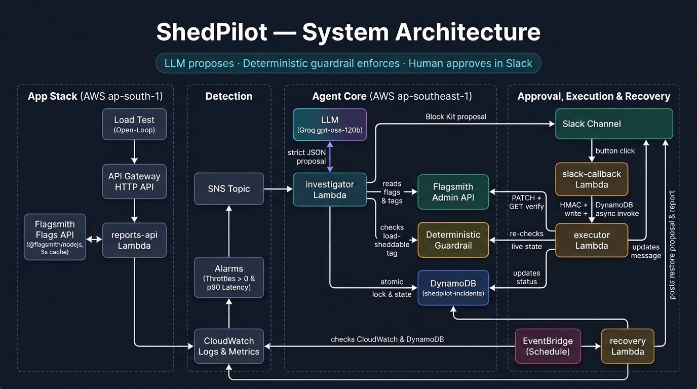
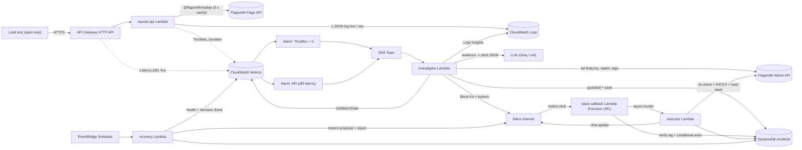

# ShedPilot

**ShedPilot** is an AI SRE agent that performs evidence-based load shedding with [Flagsmith](https://www.flagsmith.com/) feature flags and human-in-the-loop approval in Slack.

Built for **Toggle Wars: The Flagsmith Experimentation Hackathon** (Track 2: *AI Agents and Feature Flags*).

---

## The Problem

When a serverless API hits a traffic spike or a slow dependency, heavy non-essential features (like generating multi-page PDFs or running large aggregations) can consume all available Lambda concurrency. Because AWS Lambda rejects synchronous requests above its concurrency limit instead of queuing them, one expensive endpoint causes **collateral throttling** across critical routes like checkout.

Static kill switches require a human to notice the alert, open CloudWatch, guess which feature is responsible, and manually toggle flags. Simple "alarm fires -> disable everything" scripts aren't agents and risk turning off core functionality.

## How ShedPilot Works

ShedPilot separates **diagnosis**, **enforcement**, **approval**, and **execution**:

1. **Detect**: CloudWatch alarms on `AWS/Lambda Throttles` and `AWS/ApiGateway Latency (p90)` publish to SNS.
2. **Deduplicate & Settle**: `investigator` claims an atomic DynamoDB lock (`LOCK#reports-api`) so concurrent alarms create one incident, posts an initial `"Investigating..."` status to Slack, and waits for CloudWatch metrics to settle.
3. **Measure**: It queries CloudWatch `GetMetricData` for throttles, 5xx, concurrency, and latency, plus a CloudWatch Logs Insights query over structured per-request JSON logs (`feature_timings_ms.<flag>`) to measure exactly which flagged feature consumed the compute.
4. **Propose (LLM)**: An LLM (`openai/gpt-oss-120b` via Groq by default, with xAI Grok and rule-based fallback supported behind `LlmProvider`) outputs strict JSON proposing the **minimum** set of flags to disable with the lowest user impact.
5. **Enforce Guardrails**: Deterministic code checks every proposed action against live Flagsmith state: the flag must exist, be currently enabled, have action `"disable"`, and carry the `load-sheddable` tag (capped at 3 flags). Anything else (e.g., `checkout_core`) is stripped and shown openly in Slack under **Blocked by the guardrail**.
6. **Approve in Slack**: An on-call engineer clicks **Approve** or **Reject**. `slack-callback` verifies the Slack HMAC-SHA256 signature and timestamp, performs a conditional DynamoDB state transition (`PENDING_APPROVAL -> APPROVED`), replies within 3 seconds, and invokes `executor` asynchronously.
7. **Execute & Verify**: `executor` re-reads live Flagsmith state, re-runs the guardrail, flips the approved flags via the Flagsmith Admin API, reads each flag back to verify the change, and updates the Slack message.
8. **Recover & Report**: `recovery` runs on an EventBridge schedule. It checks both that the service has been healthy for *N* complete minutes **and** (via Little's law on degraded-route request logs) that re-enabling the flag fits within spare concurrency headroom. When safe, it proposes restoring the flags via the same Slack approval path, then posts an incident report and releases the lock.

---

## Architecture



<details>
<summary>Mermaid diagram (source)</summary>



</details>

See [docs/ARCHITECTURE.md](docs/ARCHITECTURE.md) for the full incident state machine, DynamoDB schema, and architectural decision log.

---

## How Flagsmith Is Used

ShedPilot uses both Flagsmith APIs with strict key separation:

| Component | Flagsmith API | Auth | Purpose |
|---|---|---|---|
| `reports-api` | Flags API (`@flagsmith/nodejs` remote eval + 5 s in-memory cache) | `X-Environment-Key` (`ser.*` server-side key in SSM) | Evaluates `pdf_export`, `basic_csv`, `rich_analytics`, and `checkout_core` with fail-safe defaults (`pdf_export`/`rich_analytics` off, `checkout_core` on) if Flagsmith is unreachable. |
| `scripts/seed-flags.ts` | Admin API (`GET /environments/`, `POST /tags/`, `POST /features/`, `PATCH /features/{id}/`) | `Authorization: Api-Key <org-key>` | Idempotently seeds the `load-sheddable` tag and the 4 demo flags. |
| `investigator` | Admin API (`GET /environments/`, `GET /projects/{id}/tags/`, `GET /projects/{id}/features/?environment={id}&page_size=100`) | `Authorization: Api-Key <org-key>` (read path) | Fetches live per-environment flag states, descriptions, and resolved tag labels so the LLM and guardrail see current state. |
| `executor` | Admin API (`GET` & `PATCH /api/__future__/environments/{env_api_key}/features/{feature_id}/`) | `Authorization: Api-Key <org-key>` | The **only** runtime component that toggles flags. Uses the `__future__` endpoint (required for Feature Versioning v2 environments) and immediately reads back state with `GET` to verify. |

---

## Safety Model ("LLM Proposes, Code Decides")

1. **No LLM tool access**: The LLM has zero credentials and zero Flagsmith tools. It receives compacted numeric evidence and returns JSON.
2. **Strict schema & parser**: Requests use strict `json_schema` decoding (`proposalParser.ts`), clip string lengths, allow one malformed-JSON retry, and fall back visibly to deterministic rules if the API fails.
3. **Double guardrail enforcement**: `checkShedActions` and `checkRestoreFlags` ([agent/lib/guardrails.ts](agent/lib/guardrails.ts)) enforce `load-sheddable` tag membership, live flag state, `"disable"` action, deduplication, and max 3 flags per proposal—both at proposal time and again in `executor` right before calling Flagsmith.
4. **Human approval gate**: `executor` only runs if DynamoDB already holds `APPROVED` or `RESTORE_APPROVED`, written exclusively by `slack-callback` after Slack HMAC-SHA256 + 5-minute replay-window verification (`slackVerify.ts`) and an optional `APPROVER_USER_IDS` allowlist.
5. **Idempotency & auditability**: Every status change is an atomic DynamoDB `TransactWriteCommand` updating `META` conditionally on the expected status and appending an `EVENT#...` audit entry.
6. **Dry-run mode**: Deploying with `DRY_RUN=true` lets you test the full Slack approval flow while logging Flagsmith `PATCH` payloads without mutating Flagsmith.

---

## Setup & Deployment

Full step-by-step instructions live in [docs/SETUP.md](docs/SETUP.md). Summary:

1. **Install dependencies & configure `.env`**:
   ```bash
   npm install
   npm --prefix backend install
   cp .env.example .env   # Fill in Flagsmith, Slack, and Groq/xAI keys
   ```
2. **Seed Flagsmith**:
   ```bash
   npm run seed -- --dry-run
   npm run seed
   ```
3. **Store secrets in SSM and deploy both stacks** (app stack in `ap-south-1`, agent stack in `ap-southeast-1` by default so spikes cannot throttle the agent):
   ```bash
   ./scripts/put-secrets.sh
   npm run deploy:app
   npm run deploy:agent
   ```
4. **Wire Slack Interactivity**: Copy the `SlackInteractivityUrl` stack output into your Slack app (**Interactivity & Shortcuts -> Request URL**; see [docs/slack-app-manifest.yaml](docs/slack-app-manifest.yaml)).
5. **Run tests & local checks**:
   ```bash
   npm run typecheck
   npm test
   npm run llm:try
   ```
6. **Run the live demo load**:
   ```bash
   RECOVERY_EVERY_MINUTES=1 HEALTHY_MINUTES=2 ./scripts/deploy-agent.sh
   npm run load:demo
   ```
7. **Teardown** (removes both CloudFormation stacks, log groups, DynamoDB table, alarms, and `/shedpilot/*` SSM parameters):
   ```bash
   ./scripts/teardown.sh --yes
   ```

---

## Sample Slack Proposal & Incident Report

### Proposal Message (with Guardrail Rejection Visible)
```text
🚨 reports-api is overloaded

Diagnosis
The Lambda hit its concurrency limit (peakConcurrency 10) and throttled 676 requests.
Served logs show 638 requests, with pdf_export responsible for 476 requests and 94.7% of total compute (avg 3255 ms).

Throttled requests (5 min): 676     API 5xx (5 min): 676
Peak Lambda concurrency:    10      Worst-minute API p90: 3.6 s
Served requests (logs):     638     Lambda errors: 0

Where the compute went (served requests, last 5 min)
flag             requests  avg ms  p90 ms  share
pdf_export            476    3255    4120    95%
rich_analytics         82     715     980     4%
basic_csv              40       1       2     0%
checkout_core          40       1       2     0%

Proposed: turn off pdf_export
Why: PDF export consumes the overwhelming majority of compute; turning it off removes most load.
Expected effect: Compute drops by ~95%, eliminating throttles on other routes including checkout.
User impact: Users cannot generate PDF reports; they receive a fast degraded response instead.

🛡️ Blocked by the guardrail (never offered for approval):
• checkout_core: missing tag load-sheddable

[ Approve ]   [ Reject ]
Incident inc-20261114-082017-d970 · proposed by openai/gpt-oss-120b in 2.4 s · confidence high · checked by the guardrail · nothing changes until a human approves
```

### Resolution Incident Report
```text
📋 Incident report: inc-20261114-082017-d970
Service: reports-api   Flags shed: pdf_export
Total time degraded: 9 min   Alarm to proposal: 1 min   Alarm to resolution: 12 min
Shed approved by: @jeevesh   Restore approved by: @jeevesh

Cause (measured): pdf_export used 92% of compute (430 requests, avg 3100 ms). 520 requests were throttled and concurrency peaked at 10.
Proposed by: openai/gpt-oss-120b

Timeline (UTC)
08:20:17  Alarm shedpilot-reports-api-throttles received, investigation started
08:21:28  Proposed turning off pdf_export; waiting for human approval
08:23:15  Approved by jeevesh (U...) in Slack
08:23:24  Load shed: pdf_export turned off, approved by jeevesh
08:27:37  Recovery check: not yet, still throttling: 91 throttled requests in the last 2 min
08:28:37  Recovery check: ready, healthy for 2 min, and no traffic is waiting on the disabled flags
08:31:50  Resolved: pdf_export back on, approved by jeevesh
```

---

## Limitations

- **Experimental Flagsmith write endpoint**: `executor` uses `PATCH /api/__future__/environments/{env_key}/features/{feature_id}/` because Feature Versioning v2 environments reject legacy `featurestates` writes. It requires **Change Requests** to be disabled in the target environment.
- **No segment/identity override inspection**: ShedPilot toggles the environment default; it does not evaluate or clear per-segment or per-identity overrides.
- **Throttled-request blind spot**: Requests rejected by Lambda concurrency throttling never execute handler code, so per-feature compute attribution comes from served requests while total rejection volume comes from CloudWatch metrics.
- **Single-service lock**: `LOCK#reports-api` serializes incidents for one target service at a time (`shedpilot-reports-api`).

---

## AI Assistance Note

This project was built with AI coding assistance (Claude Code and Gemini) from an author-designed architecture and phased plan, with every API endpoint, guardrail rule, state transition, deployment configuration, and live AWS/Flagsmith run reviewed, tested, and verified by the author.

